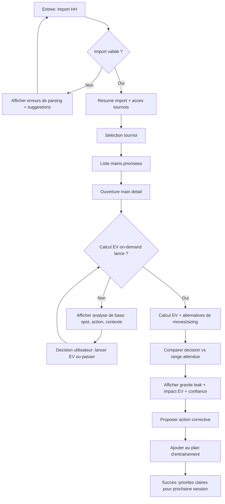
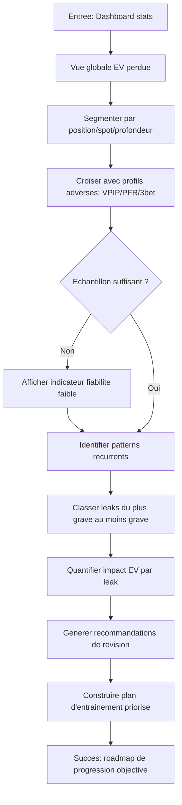
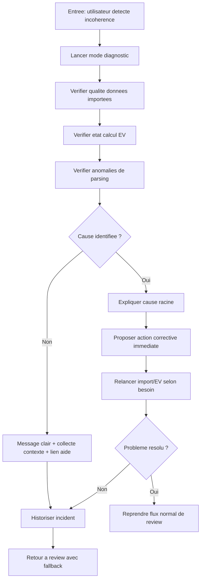

# UX Design Specification Projet-pok

**Author:** Gaetan.salber
**Date:** 2026-04-23

---

<!-- UX design content will be appended sequentially through collaborative workflow steps -->

## Executive Summary

### Project Vision

Projet-pok est une application desktop locale-first dediee a la progression poker MTT, concue pour transformer la review de mains en actions concretes d'amelioration.
Le produit vise une experience sobre et moderne qui reduit la complexite des outils existants et rend l'analyse reellement exploitable au quotidien.

### Target Users

Le MVP cible un public mixte:
- Joueurs debutants qui ont besoin de reperes clairs pour comprendre leurs erreurs.
- Joueurs intermediaires qui veulent prioriser leurs leaks et ameliorer leur prise de decision de maniere mesurable.

Le produit adresse egalement:
- Les utilisateurs orientes analyse globale (pertes EV, tendances, profils adverses).
- Les utilisateurs autonomes qui doivent diagnostiquer des problemes d'import/analyse.

### Key Design Challenges

- Rendre comprehensibles des concepts complexes (EV, ranges, leaks) sans surcharge cognitive.
- Maintenir une navigation fluide sur de gros volumes de mains et de tournois.
- Fournir un coaching neutre analytique, critique et factuel, sans biais de complaisance.
- Equilibrer besoins debutants/intermediaires dans une meme interface.

### Design Opportunities

- Construire une experience de progression orientee decision, pas seulement visualisation de stats.
- Structurer la review autour d'une triade prioritaire:
  1) Leak priorite
  2) Impact EV
  3) Range vs action jouee
- Adopter un ton de feedback analytique neutre pour renforcer la credibilite des recommandations.
- Creer une UX desktop sobre et moderne, lisible en session longue.

## Core User Experience

### Defining Experience

L'action centrale du produit est la review d'une main importante avec un diagnostic directement exploitable: leak prioritaire, impact EV et correction recommandee.
Le coeur de l'experience est de transformer une analyse technique complexe en decision d'entrainement concrete.

### Platform Strategy

Plateforme principale: desktop Windows en mode local-first, usage souris/clavier, avec experience offline par defaut.
L'interface doit privilegier la lisibilite analytique sur sessions longues.

### Effortless Interactions

- Import HH sans friction operationnelle.
- Acces direct aux mains prioritaires apres import.
- Lancement EV on-demand en un clic sur les spots selectionnes.
- Lecture immediate de "quoi corriger maintenant" sans interpretation complexe.

### Critical Success Moments

- Post-import: l'utilisateur voit instantanement les spots critiques.
- Pendant review: il comprend rapidement pourquoi une decision est -EV.
- Fin de review: il repart avec un plan de correction concret et priorise.

### Experience Principles

- Prioriser avant d'expliquer.
- Montrer l'impact avant la theorie.
- Un flux = une decision utilisateur claire.
- Feedback neutre, analytique et factuel.

## Desired Emotional Response

### Primary Emotional Goals

L'objectif emotionnel principal est de creer une lucidite durable: l'utilisateur doit voir clairement la qualite reelle de ses decisions, sans biais ni complaisance.
L'experience doit renforcer une progression fondee sur des faits mesurables plutot que sur le ressenti de session.

### Emotional Journey Mapping

- **Decouverte / ouverture de session review:** l'utilisateur doit ressentir clarte et orientation immediate.
- **Analyse des mains critiques:** l'utilisateur doit rester en focus analytique, avec une pression moderee qui soutient la concentration.
- **Lecture des resultats:** l'utilisateur doit ressentir lucidite et controle, meme quand les resultats sont negatifs.
- **Sortie de session:** l'utilisateur doit repartir avec une direction precise et applicable.

### Micro-Emotions

- **Maitrise** (micro-emotion prioritaire): sentiment de controler son processus de progression.
- **Objectivite:** confiance dans la neutralite de l'analyse.
- **Clarte:** comprehension immediate des priorites.
- **Calme actif:** concentration soutenue sans surcharge.

### Design Implications

- Le feedback doit rester neutre, factuel et explicite (pas de formulation complaisante).
- Les ecrans doivent privilegier la hierarchisation analytique: priorite leak -> impact EV -> justification range/action.
- Les messages d'erreur ou de contre-performance doivent orienter vers l'action corrective, sans dramatisation.
- Le rythme d'interface doit maintenir une pression de focus moderee (ni stress eleve, ni relachement passif).

### Emotional Design Principles

1. **Dire la verite utile:** montrer la realite du niveau de jeu de facon claire et exploitable.
2. **Preserver la maitrise utilisateur:** chaque insight doit deboucher sur une action concrete.
3. **Favoriser l'objectivite avant le confort emotionnel:** l'exactitude prime sur l'encouragement.
4. **Soutenir le focus long:** interactions sobres, stables, et lisibles pour sessions d'analyse prolongees.

## UX Pattern Analysis & Inspiration

### Inspiring Products Analysis

**GTO Wizard**
- Point fort: profondeur analytique et qualite de review de mains.
- Limite observee: complexite d'usage elevee, courbe d'apprentissage importante.

**Equilab**
- Point fort: utilite fonctionnelle pour l'analyse de ranges.
- Limite observee: interface datee, densite visuelle peu guidee.

**PokerToolkit**
- Point fort: design plus moderne et lisible.
- Point fort: revision de ranges plus directe pour l'utilisateur.
- Limite observee: potentiel d'approfondissement analytique a structurer.

### Transferable UX Patterns

- Structurer la review autour d'un flux clair et repete: spot -> diagnostic -> action.
- Donner un acces rapide aux ranges et comparaisons d'actions sur chaque main importante.
- Utiliser une hierarchie visuelle forte pour prioriser les leaks critiques.
- Garder une lisibilite moderne meme avec des donnees denses (tableaux, filtres, indicateurs).

### Anti-Patterns to Avoid

- Surcharge analytique sans priorisation claire des actions a entreprendre.
- Interfaces trop techniques qui supposent une expertise avancee des l'entree.
- Design date qui ralentit la comprehension et augmente la fatigue cognitive.
- Multiplication d'ecrans/options avant d'arriver a une recommandation utile.

### Design Inspiration Strategy

**What to Adopt**
- La rigueur analytique de GTO Wizard pour la qualite de diagnostic.
- La praticite de PokerToolkit pour les workflows de revision de ranges.
- Une hierarchie visuelle moderne pour rendre les insights immediatement exploitables.

**What to Adapt**
- Simplifier la profondeur de GTO Wizard en parcours guides pour public mixte (debutant/intermediaire).
- Transformer les vues de ranges en ecrans orientes decision (quoi corriger maintenant).

**What to Avoid**
- Complexite initiale trop elevee.
- Esthetique et patterns d'interaction dates.
- Feedback trop abstrait sans plan d'action concret.

## Design System Foundation

### 1.1 Design System Choice

Approche themeable system avec Tailwind CSS + shadcn/ui (primitives Radix) comme fondation.

### Rationale for Selection

- Equilibre entre rapidite de build et personnalisation UI.
- Adaptation ideale a une interface analytique dense (review, EV, leaks, stats).
- Coherence visuelle forte avec faible dette de maintenance.
- Compatibilite avec une strategie desktop moderne, sobre et orientee lisibilite.

### Implementation Approach

- Definir un theme central via design tokens (couleurs, typographie, espacements, etats).
- Utiliser les composants shadcn/ui comme base des patterns UI critiques.
- Construire des composants metier au-dessus de la base (cards de leaks, panneaux EV, tableaux de spots).
- Standardiser etat/feedback UX (loading, empty, error, warning, success) de facon uniforme.

### Customization Strategy

- Palette sobre (contraste fort, accent minimal) pour lecture de donnees longues sessions.
- Typographie orientee lisibilite analytique.
- Variantes de composants specifiques aux vues metier (review, comparaison range/action, priorisation leaks).
- Regles d'utilisation strictes pour garantir neutralite visuelle et coherence inter-features.

## 2. Core User Experience

### 2.1 Defining Experience

L'interaction definissante de Projet-pok est la review d'une main critique via un flux analytique unique qui fournit:
1) la priorite du leak,
2) l'impact EV,
3) la comparaison range vs action jouee,
4) l'action corrective immediate.

Cette interaction doit transformer une analyse complexe en decision concrete de progression, sans detour ni surcharge.

### 2.2 User Mental Model

L'utilisateur aborde le produit avec une attente claire:
"Je ne veux pas seulement voir des statistiques, je veux savoir quoi corriger maintenant, pourquoi c'est une erreur, et comment m'ameliorer."

Le systeme doit donc privilegier:
- la clarte de priorisation,
- l'explication causale des erreurs,
- la conversion immediate en action.

### 2.3 Success Criteria

Le core experience est reussi quand:
- l'utilisateur identifie en quelques secondes si la main est critique,
- il comprend sans ambiguite la cause de la perte EV,
- il sait exactement quelle correction appliquer,
- il termine la review avec des actions ordonnees et exploitables.

### 2.4 Novel UX Patterns

Le produit s'appuie sur des patterns etablis (liste + detail + recommandation), mais les combine en un pattern metier specifique:
**prioriser -> quantifier -> expliquer -> agir**.

Cette combinaison constitue la singularite UX de Projet-pok:
- priorisation explicite des leaks,
- quantification objective de l'impact,
- explication analytique neutre,
- orientation immediate vers la progression.

### 2.5 Experience Mechanics

**1. Initiation**
- L'utilisateur importe ses HH et accede a une liste de mains priorisees.
- Le systeme met en avant les spots a plus fort impact.

**2. Interaction**
- L'utilisateur ouvre une main.
- Un panneau d'analyse unifie presente leak prioritaire, EV, ecart range/action et contexte.

**3. Feedback**
- Le systeme fournit un feedback neutre, factuel et actionnable.
- Les signaux critiques sont visibles immediatement (gravite, impact, fiabilite).

**4. Completion**
- L'utilisateur ajoute la correction proposee a son plan de progression.
- La session se termine avec un ensemble de priorites claires pour la prochaine etape.

## Visual Design Foundation

### Color System

Le systeme visuel retenu est **Theme A - Dark Analyst** pour soutenir des sessions longues de review avec une fatigue visuelle reduite et une lecture analytique stable.

Palette fond/surfaces:
- Background primaire: `#0B1020`
- Surface secondaire: `#121A2B`
- Surface tertiaire (cards/tableaux): `#1A2438`

Palette texte:
- Texte principal: `#E6EDF7`
- Texte secondaire: `#A9B4C7`
- Texte desactive: `#6B778C`

Accent analytique:
- Accent principal (actions focus, selection): `#4F8CFF`
- Accent secondaire (infos techniques): `#60A5FA`

Couleurs semantiques (leaks/etat):
- Success / conforme: `#22C55E`
- Warning / attention: `#F59E0B`
- Critical / leak majeur: `#EF4444`
- Info / neutre analytique: `#38BDF8`

Mapping semantique:
- `primary`: accent analytique
- `surface`: couches de panneaux et cartes
- `muted`: informations secondaires
- `success`, `warning`, `danger`, `info`: signaux d'etat et gravite

### Typography System

Le systeme typographique privilegie lisibilite, neutralite et precision numerique.

Polices:
- UI principale: **Inter**
- Donnees numeriques/EV/stats: **JetBrains Mono**

Echelle typographique:
- H1: 28/32, semibold
- H2: 22/28, semibold
- H3: 18/24, medium
- Body: 14/22, regular
- Data dense: 13/20, regular
- Labels meta: 12/16, medium

Principes:
- Hierarchie courte et explicite pour faciliter le balayage visuel.
- Donnees critiques (EV, ecarts, priorites) rendues avec contraste fort et alignement stable.
- Eviter les effets decoratifs: la clarte analytique prime.

### Spacing & Layout Foundation

La structure vise une densite efficace sans surcharge cognitive.

Regles d'espacement:
- Unite de base: **8px**
- Espacement intra-composant: 8 a 16px
- Espacement inter-sections: 24px
- Separation des blocs majeurs: 32px

Grille et layout:
- Grille desktop: **12 colonnes**
- Pattern principal: **liste priorisee des mains (gauche) + detail analytique (droite)**
- Navigation orientee decision: acces direct au spot critique, puis lecture du diagnostic et de l'action corrective.

Principes de composition:
- Priorite visuelle constante: leak -> impact EV -> cause -> action.
- Alignements stricts pour tableaux/stats afin de limiter l'effort de lecture.
- White space fonctionnel: respiration suffisante sans perdre la densite d'information utile.

### Accessibility Considerations

- Cible de contraste: **WCAG AA** minimum pour texte et elements interactifs.
- La gravite ne doit jamais dependre uniquement de la couleur (labels et icones obligatoires).
- Taille lisible minimale: 13-14px pour contenus frequents.
- Etats focus clavier visibles et consistants sur actions critiques.
- Etats d'erreur/warning explicites, avec message orientee action.

## Design Direction Decision

### Design Directions Explored

Six directions visuelles ont ete explorees dans le showcase HTML:
- Direction 1: Split Review Classic (priorisation forte)
- Direction 2: Command Center (vue operationnelle)
- Direction 3: Dense Data Grid (densite maximale)
- Direction 4: Coaching Timeline (lecture narrative)
- Direction 5: Minimal Focus (anti-surcharge)
- Direction 6: Hybrid Pro (equilibre review + stats + plan)

Toutes les variations ont applique la fondation visuelle du Theme A (Dark Analyst), avec des differences sur la hierarchie, la densite et les interactions.

### Chosen Direction

Direction retenue: **base Direction 6 (Hybrid Pro)**, combinee avec la clarte immediate de la **Direction 1 (Split Review Classic)**.

Composition retenue:
- Structure principale gauche/droite (liste priorisee + detail analytique).
- Intention MVP pragmatique: review rapide, EV on-demand, stats adverses utiles.
- Lecture orientee action immediate: leak critique -> impact EV -> cause -> correction.

### Design Rationale

Cette direction est choisie car elle offre le meilleur compromis entre:
- lisibilite immediate pour sessions de review longues,
- densite d'information suffisante pour utilisateurs intermediaires,
- simplicite de navigation pour un MVP desktop local-first,
- alignement fort avec le principe produit "prioriser -> quantifier -> expliquer -> agir".

Elle preserve un ton neutre et analytique, sans gamification visuelle ni surcharge decorative.

### Implementation Approach

- Demarrer avec un layout desktop stable en deux panneaux:
  - panneau gauche: file de spots/mains prioritaires,
  - panneau droit: detail contextuel et diagnostic.
- Standardiser les composants critiques: carte leak, bloc EV, comparaison range/action, CTA de correction.
- Integrer EV on-demand et stats adverses dans des onglets secondaires pour eviter la surcharge initiale.
- Maintenir une hierarchie stricte des signaux (gravite, impact, fiabilite) avec labels explicites.
- Verrouiller les tokens Theme A pour garantir coherence et maintenabilite.

## User Journey Flows

### Journey 1 - Review main critique de bout en bout

Objectif: transformer rapidement une main importante en action d'amelioration concrete.

### Journey 2 - Analyse globale leaks et statistiques adverses

Objectif: identifier les zones les plus couteuses et prioriser les efforts.

### Journey 3 - Auto-diagnostic incident import/EV

Objectif: permettre une resolution autonome et rapide sans bloquer la review.

### Journey Patterns

- Navigation en "liste priorisee -> detail -> action".
- Decision patterns constants: valider qualite donnees, evaluer impact EV, appliquer correction.
- Feedback patterns: gravite + impact + fiabilite toujours visibles.
- Recovery patterns: erreur explicite, action proposee, reprise rapide sans perdre le contexte.

### Flow Optimization Principles

- Minimiser le temps vers la valeur: acceder au spot critique en peu d'etapes.
- Reduire la charge cognitive: une decision principale par ecran.
- Afficher des signaux standards sur tous les parcours (gravite, EV, fiabilite).
- Garder EV on-demand pour controler latence et focus utilisateur.
- Inclure des chemins de recuperation clairs pour tout echec import/EV.

## Component Strategy

### Design System Components

Composants de base couverts par shadcn/ui + Radix (a reutiliser en priorite):
- Layout: Card, Separator, ScrollArea, Tabs, Sheet, Dialog
- Form/Input: Button, Input, Select, Combobox, Checkbox, RadioGroup, Switch
- Feedback: Alert, Badge, Tooltip, Toast, Progress, Skeleton
- Data display: Table, Accordion, Collapsible
- Navigation: Breadcrumb, Pagination, Menubar

Gap principal:
- Les composants metier poker (leaks/EV/range/actions de progression) ne sont pas disponibles nativement et doivent etre implementes en custom.

### Custom Components

### LeakPriorityCard

**Purpose:** afficher un leak avec gravite, impact EV et action immediate.  
**Usage:** liste priorisee des fuites et panneau detail.  
**Anatomy:** titre leak, score gravite, EV perdu, niveau confiance, CTA "Ajouter au plan".  
**States:** default, hover, selected, loading, empty, error.  
**Variants:** compact (liste), detailed (panneau droite).  
**Accessibility:** role article, titre lie, badges avec texte explicite, focus visible clavier.  
**Content Guidelines:** une recommandation principale max par carte.  
**Interaction Behavior:** clic carte = detail; clic CTA = ajout plan.

### EvImpactPanel

**Purpose:** presenter le resultat EV on-demand d'une main.  
**Usage:** zone centrale de review detaillee.  
**Anatomy:** EV action jouee, EV alternatives, delta EV, indicateur fiabilite.  
**States:** idle (pas calcule), computing, success, failed.  
**Variants:** standard, expanded (avec details sizing).  
**Accessibility:** annonces ARIA pour debut/fin calcul, tableau lisible clavier.  
**Interaction Behavior:** bouton "Calculer EV", refresh contexte, export note.

### RangeActionComparator

**Purpose:** comparer decision joueur vs range attendue.  
**Usage:** apres calcul EV ou analyse spot.  
**Anatomy:** action jouee, action recommandee, ecart, explication pedagogique.  
**States:** match, slight_deviation, major_deviation, no_data.  
**Variants:** inline, full panel.  
**Accessibility:** codes couleur toujours doubles par labels textuels.  
**Interaction Behavior:** hover/click pour details par position/profondeur.

### OpponentStatsStrip

**Purpose:** afficher stats adverses pertinentes (VPIP/PFR/3bet/foldto3bet/AF).  
**Usage:** contexte main et filtres d'analyse.  
**Anatomy:** stats clees, taille echantillon, indicateur fiabilite.  
**States:** enough_sample, low_sample, unavailable.  
**Variants:** mini (header), full (detail).  
**Accessibility:** lecture numerique claire, unite et contexte explicites.  
**Interaction Behavior:** clic stat = filtre les spots associes.

### ReviewActionPlanPanel

**Purpose:** convertir les constats en plan d'entrainement actionnable.  
**Usage:** fin de review et synthese session.  
**Anatomy:** liste actions, priorite, effort estime, statut suivi.  
**States:** empty, populated, completed_item, blocked.  
**Variants:** session, multi-session.  
**Accessibility:** checklist clavier complete, labels d'etat textuels.  
**Interaction Behavior:** ajout depuis Leak card, reordonnancement par priorite.

### DiagnosticIssueTimeline

**Purpose:** suivre incidents d'import/analyse et resolutions.  
**Usage:** mode diagnostic + historique incidents.  
**Anatomy:** evenement, cause, action recommandee, statut resolution.  
**States:** open, in_progress, resolved, unresolved.  
**Variants:** latest-first, grouped-by-type.  
**Accessibility:** timeline lisible clavier/screen reader, severite textualisee.  
**Interaction Behavior:** relance action corrective depuis item timeline.

### Component Implementation Strategy

- Utiliser shadcn/ui comme fondation, sans recreer les composants standards.
- Construire les composants metier en composition de primitives Radix.
- Appliquer strictement les tokens du Theme A (couleur, typo, spacing).
- Harmoniser les etats loading/empty/error/success pour coherence UX.
- Integrer accessibilite AA et navigation clavier des la V1.
- Definir des interfaces TypeScript stables pour EV, leaks, stats, diagnostic.

### Implementation Roadmap

**Phase 1 - Core Components (MVP critique)**
- LeakPriorityCard
- EvImpactPanel
- RangeActionComparator

**Phase 2 - Supporting Components**
- OpponentStatsStrip
- ReviewActionPlanPanel

**Phase 3 - Enhancement Components**
- DiagnosticIssueTimeline
- Variantes avancees (expanded panels, filtres experts)

## UX Consistency Patterns

### Button Hierarchy

- **Primary button**: action principale de progression (ex: Calculer EV, Ajouter au plan).
- **Secondary button**: action de support (ex: Voir details, Filtrer).
- **Tertiary/Ghost**: action faible priorite (ex: Annuler, Fermer).
- **Danger button**: action destructive (ex: suppression/reset), toujours avec confirmation.
- Regle structurelle: une seule primary action par zone critique.
- Etats requis: default, hover, focus, disabled, loading.
- Accessibilite: focus ring visible, labels explicites, icones jamais seules sans texte/tooltip.

### Feedback Patterns

- **Success**: confirmer une action terminee (EV calculee, action ajoutee au plan).
- **Warning**: signaler une incertitude (echantillon statistique faible).
- **Error**: expliquer cause + impact + action corrective.
- **Info**: contextualiser sans alarme (rappel mode local-first, contraintes de donnees).
- Structure de message standard: ce qui se passe -> impact -> prochaine action.
- Timing: toast court pour success/info, etat persistant pour warning/error jusqu'a action utilisateur.

### Form Patterns

- Validation en deux temps:
  - inline immediate (format/obligatoire),
  - post-submit (coherence metier).
- Messages d'erreur orientee correction, jamais vagues.
- Champs sensibles (chemins import, options parsing): helper text + exemple attendu.
- Hiarchie d'actions stable: primary "Valider/Importer", secondary "Annuler".
- Accessibilite: label explicite, aria-describedby pour aide/erreur, ordre clavier logique.

### Navigation Patterns

- Navigation principale laterale stable:
  - Dashboard
  - Tournois
  - Review
  - Leaks
  - Stats
  - Diagnostic
- Pattern dominant: liste priorisee -> detail analytique -> action.
- Preservation de contexte: filtres memorises, scroll conserve, retour au dernier spot.
- Breadcrumb pour vues profondes (tournoi > main > analyse EV).
- Raccourcis clavier sur flux review intensif (next/prev main, focus filtres, lancer EV).

### Additional Patterns

**Modal / Overlay**
- Reserve aux decisions a risque et configurations ponctuelles.
- Eviter les modales pour contenu analytique long.

**Loading States**
- Skeletons sur listes/panneaux + progression explicite sur import/calcul EV.

**Empty States**
- Message explicite + CTA utile (ex: "Importer des HH").

**Search & Filtering**
- Filtres persistants sur session.
- Reset filtres toujours visible.
- Indicateur du nombre de filtres actifs.

**Diagnostic Pattern**
- Sequence standard: incident -> cause -> action corrective -> relance -> statut.

### Design System Integration Rules

- Utiliser prioritairement les composants shadcn/ui pour l'homogeneite.
- Implementer les comportements metier via wrappers custom (LeakPriorityCard, EvImpactPanel, etc.).
- Conserver la hierarchie visuelle du Theme A sur tous les ecrans.
- Toujours afficher la trilogie analytique: gravite, impact EV, fiabilite.

## Responsive Design & Accessibility

### Responsive Strategy

- Contexte produit: MVP desktop Windows first, avec base adaptable pour extension tablette/mobile.
- Desktop (priorite MVP):
  - layout a 2 panneaux (liste priorisee gauche, detail analytique droite),
  - densite d'information elevee avec hierarchie stricte,
  - raccourcis clavier pour review intensive.
- Tablet (preparation V2):
  - layout empile et panneaux repliables,
  - interactions tactiles optimisees,
  - conservation du flux prioriser -> quantifier -> expliquer -> agir.
- Mobile (future extension):
  - navigation simplifiee,
  - focus sur spots prioritaires, EV on-demand, action corrective,
  - reduction de densite et divulgation progressive des details.

### Breakpoint Strategy

- Strategie: desktop-first pragmatique, compatible extension responsive.
- Breakpoints recommandes:
  - sm: 640px
  - md: 768px
  - lg: 1024px
  - xl: 1280px
  - 2xl: 1536px
- Regles d'adaptation:
  - >=1024px: layout complet 2 colonnes,
  - 768-1023px: layout hybride (alternance liste/detail),
  - <768px: layout mono-colonne oriente tache.

### Accessibility Strategy

- Niveau cible: WCAG 2.1 AA.
- Exigences cles:
  - contraste minimum 4.5:1 pour texte normal,
  - navigation complete au clavier,
  - focus visible systematique,
  - informations critiques jamais codees uniquement par couleur,
  - compatibilite lecteur d'ecran pour leaks, EV, stats, diagnostic,
  - cibles tactiles >=44x44px pour extension tactile.
- Specificites metier:
  - fiabilite statistique toujours exprimee textuellement,
  - interpretation EV lisible sans dependance exclusive a la couleur,
  - erreurs orientees action corrective immediate.

### Testing Strategy

- Responsive:
  - tests desktop Windows sur resolutions cibles (1366x768, 1920x1080, 2560x1440),
  - verification collapse progressif des panneaux et stabilite navigation.
- Accessibilite:
  - audit automatise (axe/lighthouse),
  - tests clavier-only sur flux critiques,
  - tests NVDA (Windows) sur ecrans review/stats/diagnostic,
  - simulation daltonisme pour verifications semantiques.
- Validation UX metier:
  - confirmer acces rapide a leak prioritaire, impact EV, action corrective.

### Implementation Guidelines

- Utiliser unites relatives (rem, %, fr) et grilles flexibles.
- Preserver ordre DOM coherent avec l'ordre de lecture analytique.
- Utiliser HTML semantique et ARIA minimal necessaire.
- Gerer le focus sur modales, onglets, overlays, panneaux dynamiques.
- Standardiser etats loading/empty/error/warning/success.
- Integrer checks accessibilite dans la CI sur ecrans critiques.
